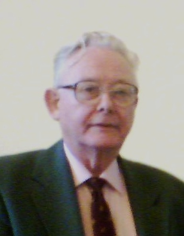

# 彼得·曼斯菲尔德

**英文名：** Peter Mansfield

**生卒：** 1933年10月9日 — 2017年2月8日

**主要领域：** 核磁共振、磁共振成像、实验物理

肖像的作者、拍摄或创作年代及具体形式见图片来源。

## 生平简介

英国物理学家，在伦敦接受高等教育，长期任教于诺丁汉大学。他从固体核磁共振转向空间成像，发展磁场梯度信号的分析与快速成像方法，与劳特伯共同获2003年诺贝尔生理学或医学奖，是物理方法进入医学诊断的重要先驱。

## 对物理的主要贡献

- 发展磁场梯度下核磁共振信号的空间编码和数学分析方法
- 提出并发展回波平面成像等快速磁共振成像技术
- 推动核磁共振的物理原理转化为医学空间成像工具

## 肖像来源与许可

- 来源：[Peter_Mansfield_Leipzig.jpg](https://commons.wikimedia.org/wiki/File:Peter_Mansfield_Leipzig.jpg)
- 作者／署名：Prolineserver
- 许可：[GFDL 1.2](http://www.gnu.org/licenses/old-licenses/fdl-1.2.html)
- 本地文件：[cbf54e55302cce7491ba-e80409b9a7.jpg](../portraits/cbf54e55302cce7491ba-e80409b9a7.jpg)
- 原始来源说明：Self-photographed

## 资料来源

- [Nobel Foundation: Peter Mansfield autobiography](https://www.nobelprize.org/prizes/medicine/2003/mansfield/biographical/)
- [University of Nottingham: Peter Mansfield papers](https://mss-cat.nottingham.ac.uk/calmview/Record.aspx?id=PPM&src=CalmView.Catalog)
- [Queen Mary University: History of Modern Biomedicine, Peter Mansfield](https://histmodbiomed.history.qmul.ac.uk/article/professor-sir-peter-mansfield.html)
- [Wikipedia: Peter Mansfield](https://en.wikipedia.org/wiki/Peter_Mansfield)

资料整理日期：2026-10-26。
