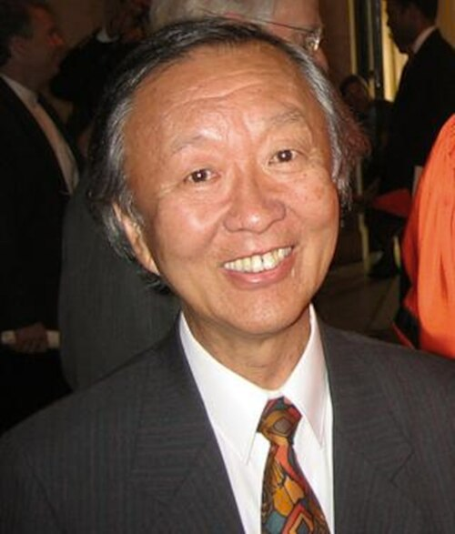

# 高锟

**英文名：** Charles Kuen Kao

**生卒：** 1933年11月4日 — 2018年9月23日

**主要领域：** 光学、光纤通信

肖像的作者、拍摄或创作年代及具体形式见图片来源。

## 生平简介

高锟出生于Shanghai, China，主要从事光学、光纤通信研究。诺贝尔奖资料所列获奖时任职机构为Standard Telecommunication Laboratories、Chinese University of Hong Kong。其代表成果包括指出高纯度玻璃可显著降低光纤损耗，获2009年诺贝尔物理学奖。

## 对物理的主要贡献

- 指出高纯度玻璃可显著降低光纤损耗
- 奠定以光纤实现长距离光通信的物理与材料研究方向

**诺贝尔物理学奖：** 2009

## 肖像来源与许可

- 来源：[Charles_K._Kao_cropped_2.jpg](https://commons.wikimedia.org/wiki/File:Charles_K._Kao_cropped_2.jpg)
- 作者／署名：David Dobkin [1]
- 许可：[CC BY-SA 3.0](https://creativecommons.org/licenses/by-sa/3.0)
- 本地文件：[54422eeb5d383361ffd0.jpg](../portraits/54422eeb5d383361ffd0.jpg)
- 原始来源说明：http://www.cs.princeton.edu/~dpd/DeanOfFaculty/person_FILES/Charles.Kao.html

## 资料来源

- [Charles K. Kao - Facts](https://www.nobelprize.org/prizes/physics/2009/kao/facts/)
- [Nobel Prize official laureate API, id 838](https://api.nobelprize.org/2.1/laureate/838)
- [Wikipedia: Charles K. Kao](https://en.wikipedia.org/wiki/Charles_K._Kao)

资料整理日期：2026-10-26。
