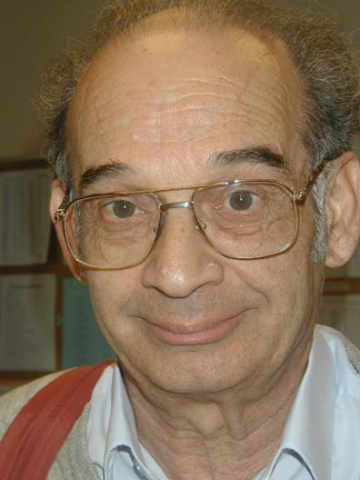

# 阿舍尔·佩雷斯

**英文名：** Asher Peres

**生卒：** 1934年1月30日 — 2005年1月1日

**主要领域：** 量子信息、量子基础

肖像的作者、拍摄或创作年代及具体形式见图片来源。

## 生平简介

以色列理论物理学家，长期任教于以色列理工学院。他以清晰而严密的方法研究量子测量、纠缠和信息处理，是量子信息理论形成时期的重要研究者。

## 对物理的主要贡献

- 提出判断纠缠的部分转置判据
- 与合作者提出量子隐形传态
- 研究量子语境性、测量与相对论量子信息

## 肖像来源与许可

- 来源：[Asher_Peres.jpg](https://commons.wikimedia.org/wiki/File:Asher_Peres.jpg)
- 作者／署名：Lev Vaidman
- 许可：[CC BY-SA 4.0](https://creativecommons.org/licenses/by-sa/4.0)
- 本地文件：[7e18ef8c4db606673f50-9c1906b89a.jpg](../portraits/7e18ef8c4db606673f50-9c1906b89a.jpg)
- 原始来源说明：Own work

## 资料来源

- [Asher Peres — Wikipedia reference biography](https://en.wikipedia.org/wiki/Asher_Peres)

资料整理日期：2026-10-26。
