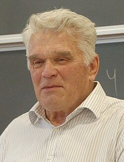

# 路德维格·法捷耶夫

**英文名：** Ludvig Faddeev

**生卒：** 1934年3月23日 — 2017年2月26日

**主要领域：** 数学物理、量子场论

肖像的作者、拍摄或创作年代及具体形式见图片来源。

## 生平简介

俄国数学物理学家，长期在列宁格勒及圣彼得堡工作。他以散射理论、规范场量子化和可积系统研究著称，推动严格数学方法进入现代场论。

## 对物理的主要贡献

- 建立三体量子散射的法捷耶夫方程
- 与波波夫提出规范场路径积分的规范固定方法
- 发展量子逆散射和可积模型理论

## 肖像来源与许可

- 来源：[Ludvig_Faddejev_(cropped).jpg](https://commons.wikimedia.org/wiki/File:Ludvig_Faddejev_(cropped).jpg)
- 作者／署名：Michael Semenov-Tian-Shansky
- 许可：[CC BY-SA 2.5](https://creativecommons.org/licenses/by-sa/2.5)
- 本地文件：[72471b8fd9b199204a38-4cc943e6e4.jpg](../portraits/72471b8fd9b199204a38-4cc943e6e4.jpg)
- 原始来源说明：Photo by Michael Semenov-Tian-Shansky

## 资料来源

- [Ludvig Faddeev — Wikipedia reference biography](https://en.wikipedia.org/wiki/Ludvig_Faddeev)

资料整理日期：2026-10-26。
