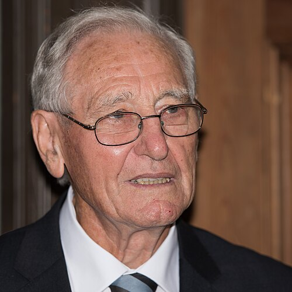

# 罗伊·克尔

**英文名：** Roy Kerr

**生卒：** 1934年5月16日 — 在世（截至资料整理日）

**主要领域：** 广义相对论、黑洞物理

肖像的作者、拍摄或创作年代及具体形式见图片来源。

## 生平简介

新西兰数学家与相对论物理学家，曾在剑桥及得克萨斯研究，后任教于坎特伯雷大学。他找到描述旋转黑洞的精确解，成为现代黑洞天体物理的重要理论基础。

## 对物理的主要贡献

- 发现旋转真空黑洞的克尔度规
- 研究爱因斯坦场方程的精确解
- 为旋转黑洞及其天体观测模型奠定基础

## 肖像来源与许可

- 来源：[Roy_Kerr_2016_03.jpg](https://commons.wikimedia.org/wiki/File:Roy_Kerr_2016_03.jpg)
- 作者／署名：Bengt Nyman
- 许可：[CC BY-SA 4.0](https://creativecommons.org/licenses/by-sa/4.0)
- 本地文件：[bfaf87eb715175e80158-f48de6055b.jpg](../portraits/bfaf87eb715175e80158-f48de6055b.jpg)
- 原始来源说明：Own work

## 资料来源

- [ICTP2025 Dirac Medallists: scientific contributions](https://www.ictp.it/home/dirac-medallists-2025)
- [Roy Kerr — Wikipedia reference biography](https://en.wikipedia.org/wiki/Roy_Kerr)
- [2025 ICTP Dirac Medal Goes to Gravity Explorers | ICTP](https://www.ictp.it/news/2025/8/2025-ictp-dirac-medal-goes-gravity-explorers)
- [Cracking the Einstein Code: Relativity and the Birth of Black Hole Physics, Melia, Kerr](http://press.uchicago.edu/ucp/books/book/chicago/C/bo6817175.html)
- [ICTP Dirac Medal — official laureate directory](https://www.ictp.it/prize/dirac-medal)

资料整理日期：2026-10-26。
