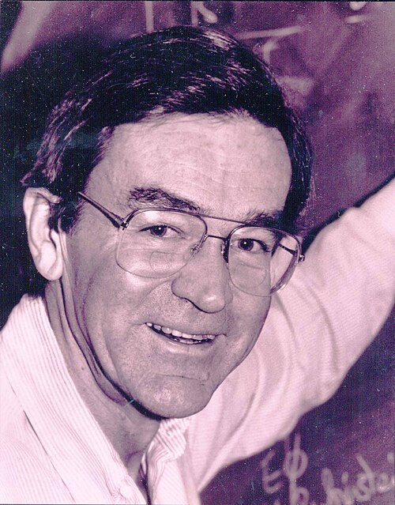

# 詹姆斯·比约肯

**英文名：** James Bjorken

**生卒：** 1934年6月22日 — 2024年8月6日

**主要领域：** 粒子物理

肖像的作者、拍摄或创作年代及具体形式见图片来源。

## 生平简介

美国理论物理学家，在斯坦福大学取得博士学位后长期在SLAC工作，也曾任职费米实验室。他将场论与高能散射实验联系起来，对夸克结构的实验确认发挥重要作用。

## 对物理的主要贡献

- 提出深度非弹性散射中的比约肯标度
- 推动部分子模型及核子内部结构研究
- 与德雷尔合著相对论量子理论教材

## 肖像来源与许可

- 来源：[James_Bjorken.jpg](https://commons.wikimedia.org/wiki/File:James_Bjorken.jpg)
- 作者／署名：见原图页面
- 许可：Public domain
- 本地文件：[8dbc19e2a0463f9ac041.jpg](../portraits/8dbc19e2a0463f9ac041.jpg)
- 原始来源说明：Downloaded from Fermilab, a.k.a. Fermi National Accelerator Laboratory image URL is: http://www.fnal.gov/pub/today/images04/bjorken.jpg Transferred from en.wikipedia to Commons by User:Magnus Manske using CommonsHelper.

## 资料来源

- [费米国家实验室历史档案：James Bjorken](https://history.fnal.gov/historical/people/bjorken_landing.html)
- [Wikipedia: James Bjorken](https://en.wikipedia.org/wiki/James_Bjorken)

资料整理日期：2026-10-26。
