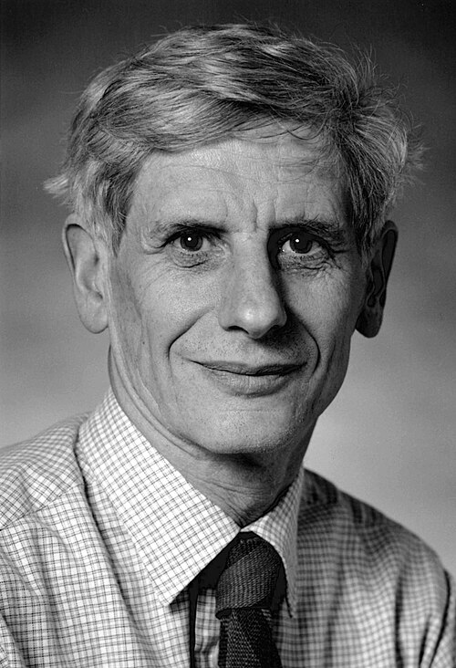

# 戴维·索利斯

**英文名：** David J. Thouless

**生卒：** 1934年9月21日 — 2019年4月6日

**主要领域：** 凝聚态物理、拓扑物态

肖像的作者、拍摄或创作年代及具体形式见图片来源。

## 生平简介

戴维·索利斯出生于Bearsden, United Kingdom，主要从事凝聚态物理、拓扑物态研究。诺贝尔奖资料所列获奖时任职机构为University of Washington。其代表成果包括与科斯特利茨研究二维体系的拓扑相变，获2016年诺贝尔物理学奖。

## 对物理的主要贡献

- 与科斯特利茨研究二维体系的拓扑相变
- 在量子霍尔效应的拓扑解释等方向作出重要贡献

**诺贝尔物理学奖：** 2016

## 肖像来源与许可

- 来源：[DavidThouless_1995_UW.jpg](https://commons.wikimedia.org/wiki/File:DavidThouless_1995_UW.jpg)
- 作者／署名：Mary Levin
- 许可：[CC BY-SA 4.0](https://creativecommons.org/licenses/by-sa/4.0)
- 本地文件：[9039a7e513f20d915df4.jpg](../portraits/9039a7e513f20d915df4.jpg)
- 原始来源说明：Published with author's permission

## 资料来源

- [David J. Thouless - Facts](https://www.nobelprize.org/prizes/physics/2016/thouless/facts/)
- [Nobel Prize official laureate API, id 928](https://api.nobelprize.org/2.1/laureate/928)
- [Wikipedia: David J. Thouless](https://en.wikipedia.org/wiki/David_J._Thouless)

资料整理日期：2026-10-26。
