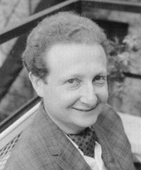

# 皮埃尔·霍恩伯格

**英文名：** Pierre Hohenberg

**生卒：** 1934年10月3日 — 2017年12月15日

**主要领域：** 凝聚态物理、统计物理

原样提取自密度泛函历史论文第24页的1965年肖像嵌入图像，已目视核对。

## 生平简介

出生于法国的美国理论物理学家，长期在贝尔实验室工作，后在纽约大学任职。他把统计物理用于量子多体和非平衡现象，在密度泛函及临界动力学中作出基础贡献。

## 对物理的主要贡献

- 与科恩证明密度泛函理论的霍恩伯格—科恩定理
- 证明低维体系长程序受到热涨落限制
- 与哈尔珀林系统分类临界动力学

## 肖像来源与许可

- 来源：[pierre-hohenberg.jpeg](https://arxiv.org/pdf/1403.5164)
- 作者／署名：见原图页面
- 许可：版权所有或再发布授权未确认；公开网页使用前须核查授权
- 本地文件：[ef8ae7d50d3f36c579b1-69f6208bc5.jpeg](../portraits/ef8ae7d50d3f36c579b1-69f6208bc5.jpeg)
- 授权状态：仅记录来源与本地档案副本；未确认可用于网站再发布，发布前须向权利人核实授权。

## 资料来源

- [纽约大学：Pierre Hohenberg纪念文集](https://physics.nyu.edu/pierre-hohenberg-memorial/pierre-hohenberg-memorial.pdf)
- [Wikipedia: Pierre Hohenberg](https://en.wikipedia.org/wiki/Pierre_Hohenberg)

资料整理日期：2026-10-26。
