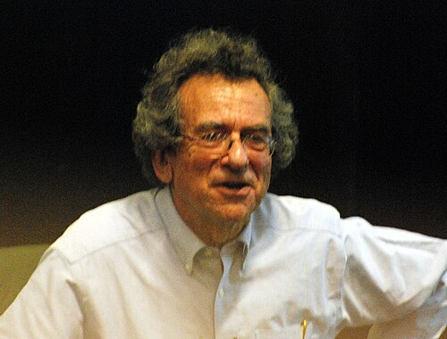

# 纳撒尼尔·戴维·默明

**英文名：** N. David Mermin

**生卒：** 1935年3月30日 — 在世（截至资料整理日）

**主要领域：** 凝聚态物理、量子基础

肖像的作者、拍摄或创作年代及具体形式见图片来源。

## 生平简介

美国理论物理学家，长期在康奈尔大学任教，以凝聚态理论、量子基础研究及清晰的物理著述著称。他与阿什克罗夫特合著的固体物理教材培养了多代研究者。

## 对物理的主要贡献

- 与瓦格纳证明低维连续对称性体系在一定条件下不存在有限温度长程序
- 研究晶体和拓扑缺陷
- 提出阐明量子非局域性与语境性的简明论证

## 肖像来源与许可

- 来源：[Mermin_Stockholm_2009.jpg](https://commons.wikimedia.org/wiki/File:Mermin_Stockholm_2009.jpg)
- 作者／署名：Prolineserver (talk)
- 许可：[CC BY-SA 3.0](https://creativecommons.org/licenses/by-sa/3.0)
- 本地文件：[35221b3d11ecdae15f86.jpg](../portraits/35221b3d11ecdae15f86.jpg)
- 原始来源说明：Own work

## 资料来源

- [Wikipedia: N. David Mermin](https://en.wikipedia.org/wiki/N._David_Mermin)

资料整理日期：2026-10-26。
