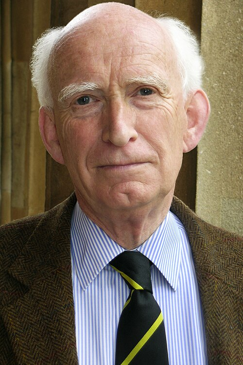

# 唐纳德·林登-贝尔

**英文名：** Donald Lynden-Bell

**生卒：** 1935年4月5日 — 2018年2月6日

**主要领域：** 星系动力学、天体物理

肖像的作者、拍摄或创作年代及具体形式见图片来源。

## 生平简介

英国理论天体物理学家，长期任教于剑桥大学。他以统计力学和动力学研究星系形成、吸积盘及星系核活动，推动黑洞成为解释高能天体现象的工具。

## 对物理的主要贡献

- 提出星系无碰撞体系的剧烈弛豫理论
- 提出活动星系核由超大质量黑洞吸积驱动
- 研究吸积盘演化与银河系动力学

## 肖像来源与许可

- 来源：[Donald_Lynden-Bell.jpg](https://commons.wikimedia.org/wiki/File:Donald_Lynden-Bell.jpg)
- 作者／署名：Institute of Astronomy, University of Cambridge – Amanda Smith
- 许可：[CC BY-SA 4.0](https://creativecommons.org/licenses/by-sa/4.0)
- 本地文件：[37fd1a3d1e5a0acdfdc6-77d38ffa6c.jpg](../portraits/37fd1a3d1e5a0acdfdc6-77d38ffa6c.jpg)
- 原始来源说明：Email correspondence; also seen at Astronomy.com

## 资料来源

- [Donald Lynden-Bell — Wikipedia reference biography](https://en.wikipedia.org/wiki/Donald_Lynden-Bell)

资料整理日期：2026-10-26。
