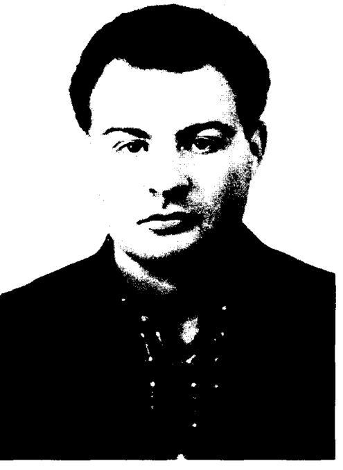

# 瓦迪姆·别列津斯基

**英文名：** Vadim Berezinskii

**生卒：** 1935年7月15日 — 1980年6月23日

**主要领域：** 凝聚态物理、统计物理

从1981年由阿布里科索夫等物理学家撰写的讣告首页忠实渲染肖像区域。

## 生平简介

苏联理论物理学家，曾在列宁格勒和莫斯科工作，研究二维体系及无序物理。他在短暂的研究生涯中提出二维体系可通过拓扑激发发生相变，深刻影响低维物理。

## 对物理的主要贡献

- 揭示二维体系可具有准长程序
- 提出涡旋解束缚驱动相变的思想，成为BKT相变理论的基础
- 研究无序体系和低维电子问题

## 肖像来源与许可

- 来源：[vadim-berezinskii.png](https://ufn.ru/ufn81/ufn81_3/ufn813j.pdf)
- 作者／署名：见原图页面
- 许可：版权所有或再发布授权未确认；公开网页使用前须核查授权
- 本地文件：[ce3fa435961db9bd4320-f864740bd7.png](../portraits/ce3fa435961db9bd4320-f864740bd7.png)
- 授权状态：仅记录来源与本地档案副本；未确认可用于网站再发布，发布前须向权利人核实授权。

## 资料来源

- [苏联物理评论：Vadim Berezinskii讣告](https://ufn.ru/ufn81/ufn81_3/ufn813j.pdf)
- [Wikipedia: Vadim Berezinskii](https://en.wikipedia.org/wiki/Vadim_Berezinskii)

资料整理日期：2026-10-26。
