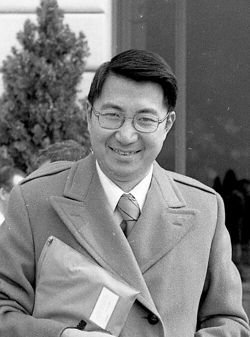

# 丁肇中

**英文名：** Samuel Chao Chung Ting

**生卒：** 1936年1月27日 — 在世（截至资料整理日）

**主要领域：** 粒子物理、实验物理

肖像的作者、拍摄或创作年代及具体形式见图片来源。

## 生平简介

丁肇中出生于Ann Arbor, MI, USA，主要从事粒子物理、实验物理研究。诺贝尔奖资料所列获奖时任职机构为Massachusetts Institute of Technology (MIT)。其代表成果包括领导布鲁克海文实验发现J粒子，与里克特组发现的ψ为同一粒子，获1976年诺贝尔物理学奖。

## 对物理的主要贡献

- 领导布鲁克海文实验发现J粒子，与里克特组发现的ψ为同一粒子
- 推动精密粒子谱学及空间粒子探测研究

**诺贝尔物理学奖：** 1976

## 肖像来源与许可

- 来源：[Samuel_Ting_1977_(cropped).jpg](https://commons.wikimedia.org/wiki/File:Samuel_Ting_1977_%28cropped%29.jpg)
- 作者／署名：AIP Emilio Segrè Visual Archives, Segrè Collection
- 许可：Attribution
- 本地文件：[be191fd86a9493cac2f9.jpg](../portraits/be191fd86a9493cac2f9.jpg)
- 原始来源说明：https://repository.aip.org/samuel-ting-0

## 资料来源

- [Samuel C.C. Ting - Facts](https://www.nobelprize.org/prizes/physics/1976/ting/facts/)
- [Nobel Prize official laureate API, id 106](https://api.nobelprize.org/2.1/laureate/106)
- [Wikipedia: Samuel C. C. Ting](https://en.wikipedia.org/wiki/Samuel_C._C._Ting)

资料整理日期：2026-10-26。
