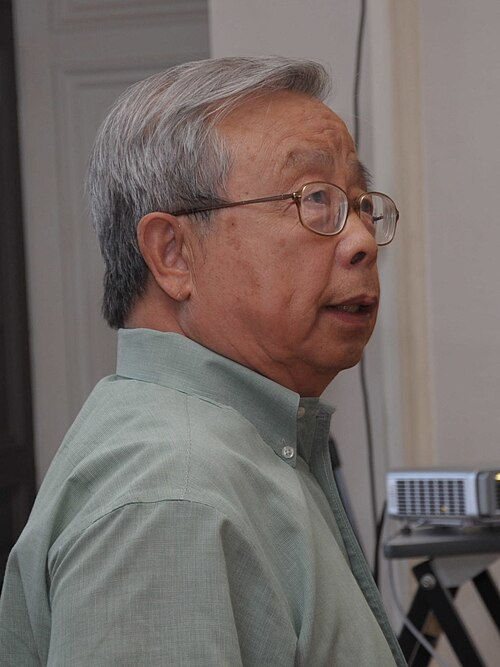

# 方励之

**英文名：** Fang Lizhi

**生卒：** 1936年2月12日 — 2012年4月6日

**主要领域：** 天体物理、宇宙学

肖像的作者、拍摄或创作年代及具体形式见图片来源。

## 生平简介

出生于北京的天体物理学家，曾在中国科学技术大学任教并担任副校长，后在美国亚利桑那大学工作。他研究宇宙学、星系形成和早期宇宙，也参与科学教育与公共讨论。

## 对物理的主要贡献

- 研究相对论宇宙学及早期宇宙
- 研究星系形成、类星体和大尺度结构
- 推动中国现代天体物理研究与教学

## 肖像来源与许可

- 来源：[Fang_Lizhi_(10455658873)_(cropped).jpg](https://commons.wikimedia.org/wiki/File:Fang_Lizhi_(10455658873)_(cropped).jpg)
- 作者／署名：Melirius
- 许可：[CC BY-SA 2.0](https://creativecommons.org/licenses/by-sa/2.0)
- 本地文件：[85bd1d63dcc8a8231815-e0e1d3c68e.jpg](../portraits/85bd1d63dcc8a8231815-e0e1d3c68e.jpg)
- 原始来源说明：DSC_0417

## 资料来源

- [Fang Lizhi — Wikipedia reference biography](https://en.wikipedia.org/wiki/Fang_Lizhi)
- [June 4, 1989: A personal recollection | Brookings](https://www.brookings.edu/blog/order-from-chaos/2019/05/29/june-4-1989-a-personal-recollection/)

资料整理日期：2026-10-26。
