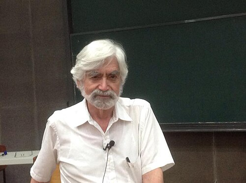

# 乔治·茨威格

**英文名：** George Zweig

**生卒：** 1937年 — 在世（截至资料整理日）

**主要领域：** 粒子物理、生物物理、信号分析

肖像的作者、拍摄或创作年代及具体形式见图片来源。

## 生平简介

出生于莫斯科的美国物理学家，幼年移居美国，在加州理工学院随费曼学习。他独立于盖尔曼提出构成强子的基本组分模型，后在洛斯阿拉莫斯和麻省理工等机构从事神经生物学、耳蜗与信号分析研究，跨越粒子物理和生物物理。

## 对物理的主要贡献

- 独立提出后来称为夸克的强子组分模型，当时称其组分为aces
- 把物理和数学方法用于耳蜗力学及听觉信号分析
- 发展与连续小波变换有关的信号处理方法

## 史料说明

- 出生年份采用本人在CERN访谈中所述1937年；未把缺少独立原始证据的具体月日写入确日字段。

## 肖像来源与许可

- 来源：[George_Zweig.jpg](https://commons.wikimedia.org/wiki/File:George_Zweig.jpg)
- 作者／署名：Peacearth
- 许可：[CC BY-SA 4.0](https://creativecommons.org/licenses/by-sa/4.0)
- 本地文件：[f60c6457f33aa54af3ac-c14f9e3081.jpg](../portraits/f60c6457f33aa54af3ac-c14f9e3081.jpg)
- 原始来源说明：Own work

## 资料来源

- [CERN EP Department: Interview with George Zweig](https://ep-news-wp.web.cern.ch/interview-george-zweig/)
- [MacArthur Foundation: George Zweig](https://www.macfound.org/fellows/class-of-december-1981/george-zweig)
- [Wikipedia: George Zweig](https://en.wikipedia.org/wiki/George_Zweig)

资料整理日期：2026-10-26。
