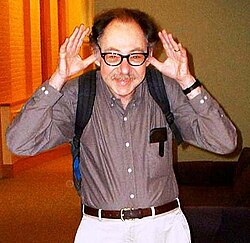

# 西德尼·科尔曼

**英文名：** Sidney Coleman

**生卒：** 1937年3月7日 — 2007年11月18日

**主要领域：** 量子场论、粒子物理

肖像的作者、拍摄或创作年代及具体形式见图片来源。

## 生平简介

美国理论物理学家，在加州理工学院取得博士学位后长期任教于哈佛大学。他以深刻的理论洞察和清晰的教学闻名，研究场论中的对称性、真空结构与非微扰现象。

## 对物理的主要贡献

- 与温伯格研究辐射修正导致的对称性破缺
- 证明二维量子场论中连续对称性破缺受到限制
- 研究假真空衰变、孤子及量子场论对偶

## 肖像来源与许可

- 来源：[Sidney_Coleman_at_Harvard_crop.jpg](https://commons.wikimedia.org/wiki/File:Sidney_Coleman_at_Harvard_crop.jpg)
- 作者／署名：Luboš Motl aka Lumidek; cropped by Beyond My Ken (talk) 22:03, 9 June 2011 (UTC))
- 许可：[CC BY-SA 3.0](http://creativecommons.org/licenses/by-sa/3.0/)
- 本地文件：[b5f7af3fb7e5d9d39987.jpg](../portraits/b5f7af3fb7e5d9d39987.jpg)
- 原始来源说明：Own work by the original uploader

## 资料来源

- [美国国家科学院：Sidney R. Coleman](https://www.nasonline.org/directory-entry/sidney-r-coleman-uqrrru/)
- [Wikipedia: Sidney Coleman](https://en.wikipedia.org/wiki/Sidney_Coleman)

资料整理日期：2026-10-26。
