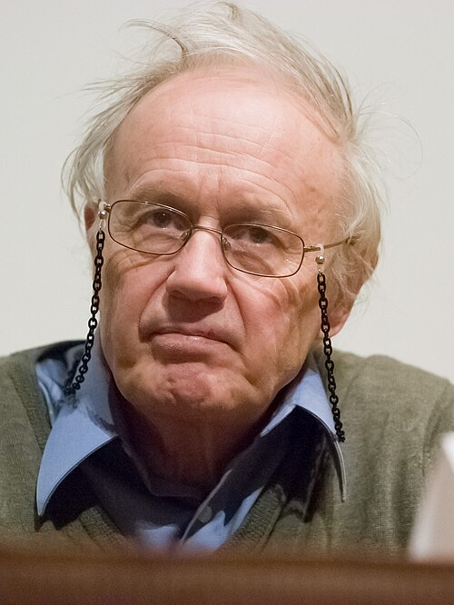

# 安东尼·莱格特

**英文名：** Anthony J. Leggett

**生卒：** 1938年3月26日 — 2026年3月8日

**主要领域：** 凝聚态物理、超流

肖像的作者、拍摄或创作年代及具体形式见图片来源。

## 生平简介

安东尼·莱格特出生于London, United Kingdom，主要从事凝聚态物理、超流研究。诺贝尔奖资料所列获奖时任职机构为University of Illinois。其代表成果包括发展氦-3超流性的理论解释，获2003年诺贝尔物理学奖。

## 对物理的主要贡献

- 发展氦-3超流性的理论解释
- 研究非常规配对与宏观量子现象

**诺贝尔物理学奖：** 2003

## 肖像来源与许可

- 来源：[Nobel_Laureate_Sir_Anthony_James_Leggett_in_2007_(cropped).jpg](https://commons.wikimedia.org/wiki/File:Nobel_Laureate_Sir_Anthony_James_Leggett_in_2007_%28cropped%29.jpg)
- 作者／署名：Kenneth C. Zirkel
- 许可：[CC BY-SA 3.0](https://commons.wikimedia.org/wiki/File:Nobel_Laureate_Sir_Anthony_James_Leggett_in_2007_%28cropped%29.jpg)
- 本地文件：[5f84e6977f97cb3db9a7.jpg](../portraits/5f84e6977f97cb3db9a7.jpg)
- 原始来源说明：Own work

## 资料来源

- [Anthony J. Leggett - Facts](https://www.nobelprize.org/prizes/physics/2003/leggett/facts/)
- [Nobel Prize official laureate API, id 768](https://api.nobelprize.org/2.1/laureate/768)
- [Wikipedia: Anthony James Leggett](https://en.wikipedia.org/wiki/Anthony_James_Leggett)

资料整理日期：2026-10-26。
