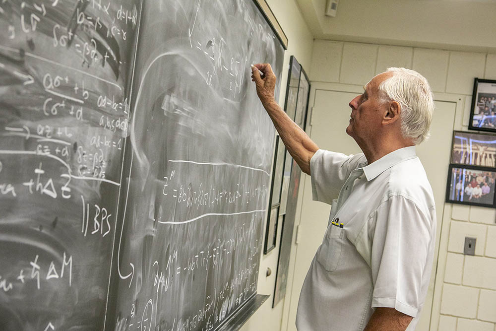

# 彼得·范纽文赫伊曾

**英文名：** Peter van Nieuwenhuizen

**生卒：** 1938年10月26日 — 在世（截至资料整理日）

**主要领域：** 超引力、量子场论

范纽文赫伊曾在黑板前工作的本人照片，来自石溪大学院系介绍。

## 生平简介

荷兰出生的理论物理学家，长期在美国石溪大学任教。他与弗里德曼、费拉拉合作建立超引力，并研究量子引力、重整化和规范体系的量子化。

## 对物理的主要贡献

- 与弗里德曼、费拉拉共同建立超引力
- 研究量子引力及超引力的紫外性质
- 发展BRST与规范场量子化研究

## 肖像来源与许可

- 来源：[modern-extra-peter-van-nieuwenhuizen.jpg](https://www.stonybrook.edu/physics/about/awards-and-prizes/profiles/vannieuwenhuizenaward.html)
- 作者／署名：见原图页面
- 许可：Copyrighted image; no transferable open licence verified. Permission must be confirmed before website publication.
- 本地文件：[cae98ea738cc6ce7eb0f-b11b49b901.jpg](../portraits/cae98ea738cc6ce7eb0f-b11b49b901.jpg)
- 原始来源说明：Stony Brook University, Department of Physics and Astronomy
- 授权状态：仅记录来源与本地档案副本；未确认可用于网站再发布，发布前须向权利人核实授权。

## 资料来源

- [Peter van Nieuwenhuizen — Wikipedia reference biography](https://en.wikipedia.org/wiki/Peter_van_Nieuwenhuizen)
- [ICTP Dirac Medal — official laureate directory](https://www.ictp.it/prize/dirac-medal)

资料整理日期：2026-10-26。
