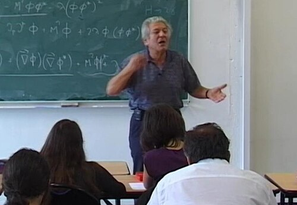

# 约翰·伊利奥普洛斯

**英文名：** John Iliopoulos

**生卒：** 1940年 — 在世（截至资料整理日）

**主要领域：** 粒子物理

肖像的作者、拍摄或创作年代及具体形式见图片来源。

## 生平简介

希腊出生的理论物理学家，曾在CERN与哈佛大学研究，后长期在巴黎高等师范学校工作。他研究弱相互作用和规范理论，在标准模型确立过程中作出重要贡献。

## 对物理的主要贡献

- 与格拉肖、马亚尼提出GIM机制并预言粲夸克的作用
- 研究规范理论、重整化及超对称
- 推动标准模型的理论发展

## 史料说明

- 已核读来源明确出生年份，暂不补充未经核对的月日。

## 肖像来源与许可

- 来源：[Jean_Iliopoulos_(Ecole_Normale_Supérieure)_-_Philippe_Binant_Archives.jpg](https://commons.wikimedia.org/wiki/File:Jean_Iliopoulos_(Ecole_Normale_Sup%C3%A9rieure)_-_Philippe_Binant_Archives.jpg)
- 作者／署名：Binant
- 许可：[CC BY-SA 4.0](https://creativecommons.org/licenses/by-sa/4.0)
- 本地文件：[b922ae223a1af199aaff.jpg](../portraits/b922ae223a1af199aaff.jpg)
- 原始来源说明：Own work

## 资料来源

- [Wikipedia: John Iliopoulos](https://en.wikipedia.org/wiki/John_Iliopoulos)

资料整理日期：2026-10-26。
