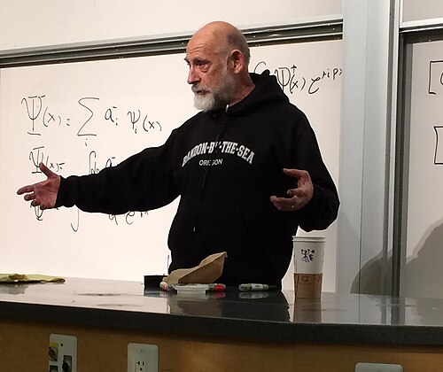

# 伦纳德·萨斯坎德

**英文名：** Leonard Susskind

**生卒：** 1940年6月16日 — 在世（截至资料整理日）

**主要领域：** 弦理论、量子引力

肖像的作者、拍摄或创作年代及具体形式见图片来源。

## 生平简介

美国理论物理学家，在康奈尔大学取得博士学位，后长期任教于斯坦福大学。他研究强相互作用的弦描述、黑洞量子信息及宇宙学，是全息思想的重要推动者。

## 对物理的主要贡献

- 参与提出粒子的弦模型
- 发展黑洞互补性与全息原理
- 研究黑洞信息、量子复杂性及量子引力之间的联系

## 肖像来源与许可

- 来源：[LeonardSusskindStanfordNov2013.jpg](https://commons.wikimedia.org/wiki/File:LeonardSusskindStanfordNov2013.jpg)
- 作者／署名：Acmedogs
- 许可：[CC BY-SA 3.0](https://creativecommons.org/licenses/by-sa/3.0)
- 本地文件：[22fb1e0ee84de2028f0c.jpg](../portraits/22fb1e0ee84de2028f0c.jpg)
- 原始来源说明：Own work

## 资料来源

- [Wikipedia: Leonard Susskind](https://en.wikipedia.org/wiki/Leonard_Susskind)

资料整理日期：2026-10-26。
