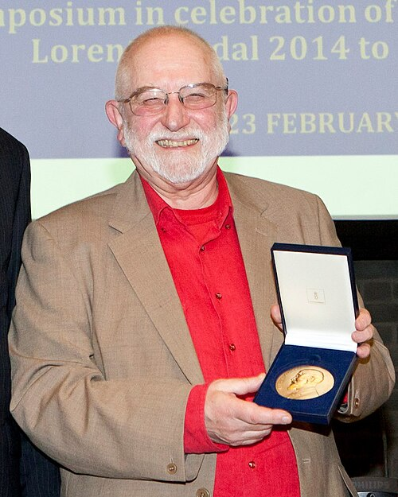

# 迈克尔·贝里

**英文名：** Michael Berry

**生卒：** 1941年3月14日 — 在世（截至资料整理日）

**主要领域：** 数学物理、波动理论

肖像的作者、拍摄或创作年代及具体形式见图片来源。

## 生平简介

英国理论物理学家，长期在布里斯托尔大学工作。他以几何和渐近分析研究量子、经典波动现象，展示了量子态演化中的几何结构，也积极阐释日常可见的物理现象。

## 对物理的主要贡献

- 发现绝热量子演化中的贝里几何相位
- 研究波场奇点、光学灾变和半经典量子理论
- 推进量子混沌与波动渐近方法

## 肖像来源与许可

- 来源：[LorentzMedaille2014-cropped.jpg](https://commons.wikimedia.org/wiki/File:LorentzMedaille2014-cropped.jpg)
- 作者／署名：KNAW Barbara Kieboom
- 许可：[CC BY 2.0](https://creativecommons.org/licenses/by/2.0)
- 本地文件：[13c5b010a09a3536218d.jpg](../portraits/13c5b010a09a3536218d.jpg)
- 原始来源说明：Cropped from Lorentz medaille 2014

## 资料来源

- [布里斯托尔大学：Michael Berry](https://www.bristol.ac.uk/news/2014/december/lorentz-medal-sir-michael-berry.html)
- [Wikipedia: Michael Berry (physicist)](https://en.wikipedia.org/wiki/Michael_Berry_%28physicist%29)

资料整理日期：2026-10-26。
