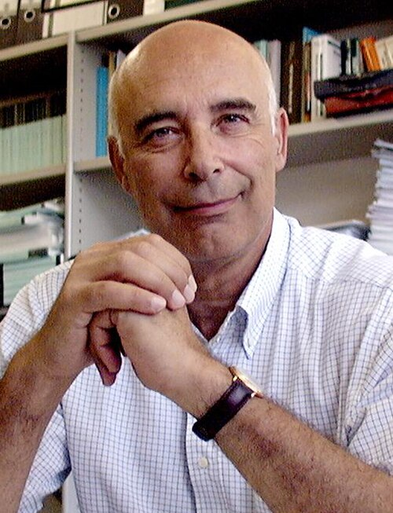

# 圭多·阿尔塔雷利

**英文名：** Guido Altarelli

**生卒：** 1941年7月12日 — 2015年9月30日

**主要领域：** 粒子物理、量子色动力学

肖像的作者、拍摄或创作年代及具体形式见图片来源。

## 生平简介

意大利理论物理学家，曾在罗马、美国和CERN工作。他将量子色动力学用于可检验的高能散射计算，是建立对撞机理论预言与实验数据比较方法的重要研究者。

## 对物理的主要贡献

- 与帕里西提出部分子分布随能标演化的方程
- 发展量子色动力学微扰计算及现象学
- 研究电弱精密检验和超越标准模型的理论

## 肖像来源与许可

- 来源：[Professor_Guido_Altarelli_(3x4_cropped).jpg](https://commons.wikimedia.org/wiki/File:Professor_Guido_Altarelli_(3x4_cropped).jpg)
- 作者／署名：CERN
- 许可：[CC BY-SA 4.0](https://creativecommons.org/licenses/by-sa/4.0)
- 本地文件：[00f8974566948d260d49.jpg](../portraits/00f8974566948d260d49.jpg)
- 原始来源说明：https://cds.cern.ch/record/41606?ln=en

## 资料来源

- [马亚尼、帕里西撰写的Guido Altarelli讣告（Physics Today）](https://physicstoday.aip.org/obituaries/guido-altarelli)
- [Wikipedia: Guido Altarelli](https://en.wikipedia.org/wiki/Guido_Altarelli)

资料整理日期：2026-10-26。
