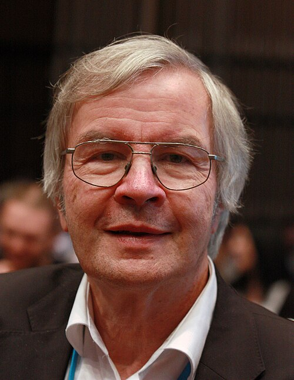

# 特奥多尔·亨施

**英文名：** Theodor W. Hänsch

**生卒：** 1941年10月30日 — 在世（截至资料整理日）

**主要领域：** 精密光谱、激光物理

肖像的作者、拍摄或创作年代及具体形式见图片来源。

## 生平简介

特奥多尔·亨施出生于Heidelberg, Germany，主要从事精密光谱、激光物理研究。诺贝尔奖资料所列获奖时任职机构为Max Planck Institute of Quantum Optics、Ludwig-Maximilians-Universität München。其代表成果包括发展高精度激光光谱及光学频率梳，获2005年诺贝尔物理学奖。

## 对物理的主要贡献

- 发展高精度激光光谱及光学频率梳
- 使光学频率与可计数的射频频率建立精确联系

**诺贝尔物理学奖：** 2005

## 肖像来源与许可

- 来源：[Theodor_Haensch.jpg](https://commons.wikimedia.org/wiki/File:Theodor_Haensch.jpg)
- 作者／署名：Markus Pössel (User: Mapos)
- 许可：[CC BY-SA 3.0](https://creativecommons.org/licenses/by-sa/3.0)
- 本地文件：[22b1e6ee2b6a99d16d15.jpg](../portraits/22b1e6ee2b6a99d16d15.jpg)
- 原始来源说明：Own work

## 资料来源

- [Theodor W. Hänsch - Facts](https://www.nobelprize.org/prizes/physics/2005/hansch/facts/)
- [Nobel Prize official laureate API, id 793](https://api.nobelprize.org/2.1/laureate/793)
- [Wikipedia: Theodor W. Hänsch](https://en.wikipedia.org/wiki/Theodor_W._H%C3%A4nsch)

资料整理日期：2026-10-26。
