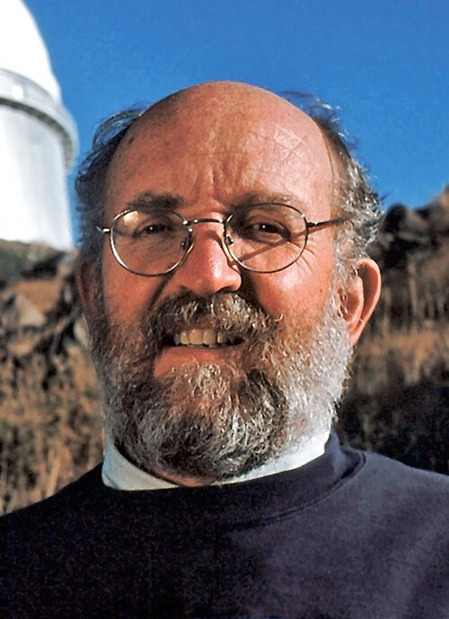

# 米歇尔·马约尔

**英文名：** Michel Mayor

**生卒：** 1942年1月12日 — 在世（截至资料整理日）

**主要领域：** 天体物理、系外行星

肖像的作者、拍摄或创作年代及具体形式见图片来源。

## 生平简介

米歇尔·马约尔出生于Lausanne, Switzerland，主要从事天体物理、系外行星研究。诺贝尔奖资料所列获奖时任职机构为University of Geneva。其代表成果包括与迪迪埃·奎洛兹发现围绕类太阳恒星运行的系外行星飞马座51b，获2019年诺贝尔物理学奖。

## 对物理的主要贡献

- 与迪迪埃·奎洛兹发现围绕类太阳恒星运行的系外行星飞马座51b
- 推进高精度径向速度行星探测

**诺贝尔物理学奖：** 2019

## 肖像来源与许可

- 来源：[Michel_Mayor,_2012_(cropped).jpg](https://commons.wikimedia.org/wiki/File:Michel_Mayor%2C_2012_%28cropped%29.jpg)
- 作者／署名：L. Weinstein/Ciel et Espace Photos
- 许可：[CC BY 4.0](https://www.eso.org/public/copyright/)
- 本地文件：[6e272745088ef17cecd1.jpg](../portraits/6e272745088ef17cecd1.jpg)
- 原始来源说明：Didier Queloz and Michel Mayor at La Silla

## 资料来源

- [Michel Mayor - Facts](https://www.nobelprize.org/prizes/physics/2019/mayor/facts/)
- [Nobel Prize official laureate API, id 974](https://api.nobelprize.org/2.1/laureate/974)
- [Wikipedia: Michel Mayor](https://en.wikipedia.org/wiki/Michel_Mayor)

资料整理日期：2026-10-26。
