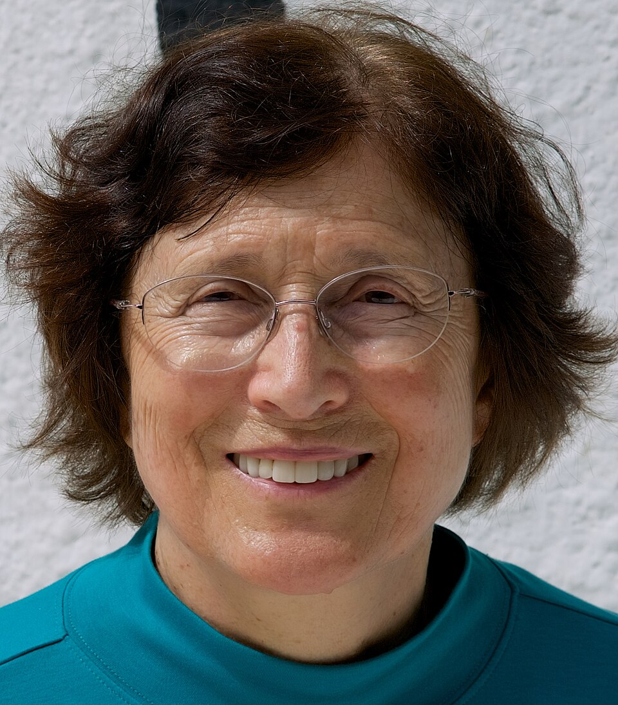

# 雷娜塔·卡洛什

**英文名：** Renata Kallosh

**生卒：** 1943年1月16日 — 在世（截至资料整理日）

**主要领域：** 超引力、宇宙学

肖像的作者、拍摄或创作年代及具体形式见图片来源。

## 生平简介

俄罗斯出生的理论物理学家，曾在列别捷夫物理研究所研究，后任教于斯坦福大学。她长期研究超对称、超引力和宇宙暴胀，连接粒子理论与早期宇宙模型。

## 对物理的主要贡献

- 研究超引力理论的量子修正及紫外性质
- 与合作者构建弦理论真空和宇宙学模型
- 发展超引力中的暴胀模型及α吸引子研究

## 肖像来源与许可

- 来源：[Renata_Kallosh_2017.jpg](https://commons.wikimedia.org/wiki/File:Renata_Kallosh_2017.jpg)
- 作者／署名：Hypermultiplet
- 许可：[CC BY-SA 4.0](https://commons.wikimedia.org/wiki/File:Renata_Kallosh_2017.jpg)
- 本地文件：[fe4b8a67a663efde4da4.jpg](../portraits/fe4b8a67a663efde4da4.jpg)
- 原始来源说明：Own work

## 资料来源

- [斯坦福大学：Renata Kallosh](https://web.stanford.edu/~rkallosh/)
- [Wikipedia: Renata Kallosh](https://en.wikipedia.org/wiki/Renata_Kallosh)

资料整理日期：2026-10-26。
