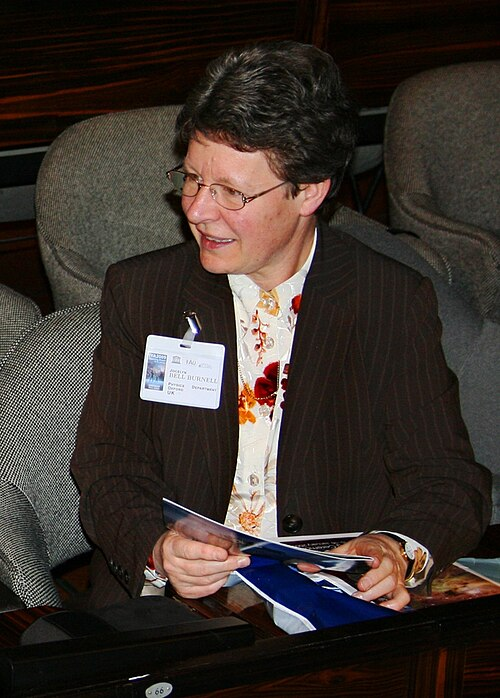

# 乔斯琳·贝尔·伯内尔

**英文名：** Jocelyn Bell Burnell

**生卒：** 1943年7月15日 — 在世（截至资料整理日）

**主要领域：** 射电天文学、中子星

肖像的作者、拍摄或创作年代及具体形式见图片来源。

## 生平简介

北爱尔兰出生的天体物理学家，作为剑桥大学研究生参与建造射电望远镜，1967年从记录纸中辨认出规律脉冲信号。此后在英国多所大学工作，并积极支持科学教育及科研公平。

## 对物理的主要贡献

- 发现首个脉冲星射电信号
- 参与确立快速旋转中子星的观测研究领域
- 推动射电及高能天文学研究

## 肖像来源与许可

- 来源：[Launch_of_IYA_2009,_Paris_-_Grygar,_Bell_Burnell_cropped.jpg](https://commons.wikimedia.org/wiki/File:Launch_of_IYA_2009,_Paris_-_Grygar,_Bell_Burnell_cropped.jpg)
- 作者／署名：Launch_of_IYA_2009,_Paris_-_Grygar,_Bell_Burnell.jpg: Astronomical Institute, Academy of Sciences of the Czech Republic derivative work: Anrie (talk)
- 许可：[CC BY-SA 3.0](https://creativecommons.org/licenses/by-sa/3.0)
- 本地文件：[693727ed938fe55fefdb.jpg](../portraits/693727ed938fe55fefdb.jpg)
- 原始来源说明：Launch_of_IYA_2009,_Paris_-_Grygar,_Bell_Burnell.jpg

## 资料来源

- [Wikipedia: Jocelyn Bell Burnell](https://en.wikipedia.org/wiki/Jocelyn_Bell_Burnell)

资料整理日期：2026-10-26。
