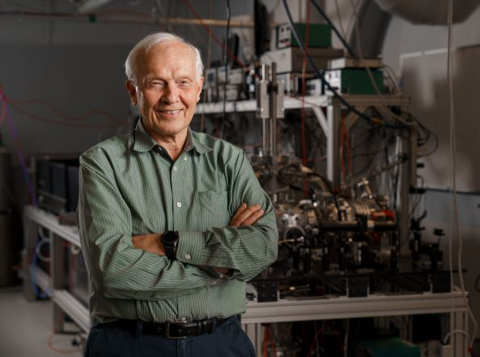

# 保罗·科库姆

**英文名：** Paul Corkum

**生卒：** 1943年10月30日 — 在世（截至资料整理日）

**主要领域：** 阿秒物理、激光物理

科克姆在实验室中的本人照片，来自渥太华大学教授介绍。

## 生平简介

加拿大实验与理论激光物理学家，长期在加拿大国家研究委员会及渥太华大学工作。他把强场电离与电子再碰撞联系起来，为高次谐波和阿秒光脉冲研究建立重要物理图像。

## 对物理的主要贡献

- 提出强场高次谐波产生的三步再碰撞模型
- 发展阿秒光脉冲及分子成像方法
- 研究激光对电子运动的超快控制

## 肖像来源与许可

- 来源：[final-portrait-paul-corkum-ottawa.jpg](https://www.uottawa.ca/faculty-science/professors/paul-corkum)
- 作者／署名：见原图页面
- 许可：Copyrighted institutional or historical photograph; no transferable open licence verified. Permission must be confirmed before website publication.
- 本地文件：[6efb6e0f023e55be8747-d6450317cd.jpg](../portraits/6efb6e0f023e55be8747-d6450317cd.jpg)
- 原始来源说明：University of Ottawa, Faculty of Science professor profile
- 授权状态：仅记录来源与本地档案副本；未确认可用于网站再发布，发布前须向权利人核实授权。

## 资料来源

- [Paul Corkum — National Research Council Canada](https://nrc.canada.ca/en/corporate/dr-paul-corkum)
- [Paul Corkum — Wikipedia reference biography](https://en.wikipedia.org/wiki/Paul_Corkum)

资料整理日期：2026-10-26。
