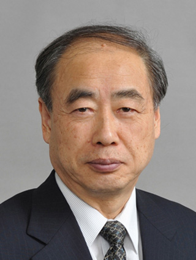

# 小林诚

**英文名：** Makoto Kobayashi

**生卒：** 1944年4月7日 — 在世（截至资料整理日）

**主要领域：** 粒子物理、夸克混合

肖像的作者、拍摄或创作年代及具体形式见图片来源。

## 生平简介

小林诚出生于Nagoya, Japan，主要从事粒子物理、夸克混合研究。诺贝尔奖资料所列获奖时任职机构为High Energy Accelerator Research Organization (KEK)。其代表成果包括与益川敏英提出六夸克混合框架，获2008年诺贝尔物理学奖。

## 对物理的主要贡献

- 与益川敏英提出六夸克混合框架
- 解释弱相互作用中CP对称性破坏的可能机制

**诺贝尔物理学奖：** 2008

## 肖像来源与许可

- 来源：[Makoto_Kobayashi_20101223.jpg](https://commons.wikimedia.org/wiki/File:Makoto_Kobayashi_20101223.jpg)
- 作者／署名：日本学士院
- 许可：[CC BY 4.0](https://commons.wikimedia.org/wiki/Commons:Non-copyright_restrictions)
- 本地文件：[4af8c8f4bd1b9d45b3ae.jpg](../portraits/4af8c8f4bd1b9d45b3ae.jpg)
- 原始来源说明：https://www.japan-acad.go.jp/japanese/members/4/kobayashi_makoto.html

## 资料来源

- [Makoto Kobayashi - Facts](https://www.nobelprize.org/prizes/physics/2008/kobayashi/facts/)
- [Nobel Prize official laureate API, id 827](https://api.nobelprize.org/2.1/laureate/827)
- [Wikipedia: Makoto Kobayashi (physicist)](https://en.wikipedia.org/wiki/Makoto_Kobayashi_%28physicist%29)

资料整理日期：2026-10-26。
