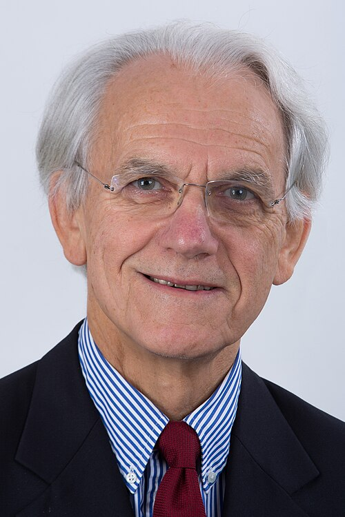

# 热拉尔·穆鲁

**英文名：** Gérard Mourou

**生卒：** 1944年6月22日 — 在世（截至资料整理日）

**主要领域：** 激光物理、超快光学

肖像的作者、拍摄或创作年代及具体形式见图片来源。

## 生平简介

热拉尔·穆鲁出生于Albertville, France，主要从事激光物理、超快光学研究。诺贝尔奖资料所列获奖时任职机构为École Polytechnique、University of Michigan。其代表成果包括与唐娜·斯特里克兰共同提出啁啾脉冲放大，获2018年诺贝尔物理学奖。

## 对物理的主要贡献

- 与唐娜·斯特里克兰共同提出啁啾脉冲放大
- 通过展宽、放大和压缩实现高强度超短激光脉冲

**诺贝尔物理学奖：** 2018

## 肖像来源与许可

- 来源：[Gérard_Mourou,_2014.jpg](https://commons.wikimedia.org/wiki/File:G%C3%A9rard_Mourou,_2014.jpg)
- 作者／署名：École polytechnique
- 许可：[CC BY-SA 2.0](https://creativecommons.org/licenses/by-sa/2.0)
- 本地文件：[7112d83618189a433ea5.jpg](../portraits/7112d83618189a433ea5.jpg)
- 原始来源说明：Ecole polytechnique

## 资料来源

- [Gérard Mourou - Facts](https://www.nobelprize.org/prizes/physics/2018/mourou/facts/)
- [Nobel Prize official laureate API, id 961](https://api.nobelprize.org/2.1/laureate/961)
- [Wikipedia: Gérard Mourou](https://en.wikipedia.org/wiki/G%C3%A9rard_Mourou)

资料整理日期：2026-10-26。
