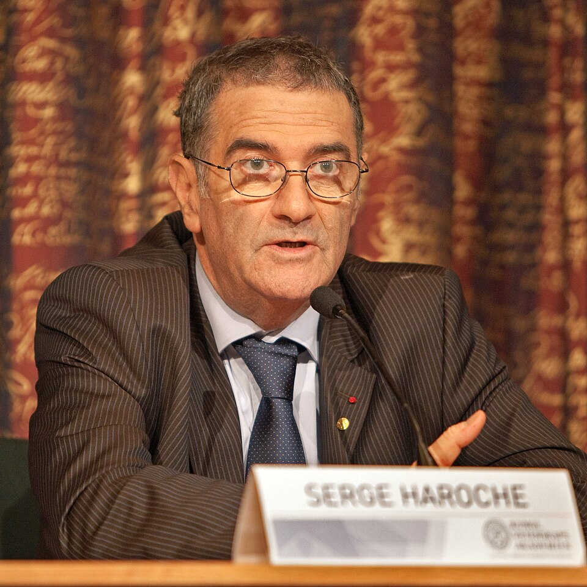

# 塞尔日·阿罗什

**英文名：** Serge Haroche

**生卒：** 1944年9月11日 — 在世（截至资料整理日）

**主要领域：** 量子光学、量子信息

肖像的作者、拍摄或创作年代及具体形式见图片来源。

## 生平简介

塞尔日·阿罗什出生于Casablanca, Morocco，主要从事量子光学、量子信息研究。诺贝尔奖资料所列获奖时任职机构为Collège de France、École Normale Supérieure。其代表成果包括利用腔量子电动力学操纵光子与原子的相互作用，获2012年诺贝尔物理学奖。

## 对物理的主要贡献

- 利用腔量子电动力学操纵光子与原子的相互作用
- 实现对单个光子量子态的非破坏性测量和量子相干研究

**诺贝尔物理学奖：** 2012

## 肖像来源与许可

- 来源：[Serge_Haroche_1_2012.jpg](https://commons.wikimedia.org/wiki/File:Serge_Haroche_1_2012.jpg)
- 作者／署名：Bengt Nyman
- 许可：[CC BY 2.0](https://commons.wikimedia.org/wiki/File:Serge_Haroche_1_2012.jpg)
- 本地文件：[e558e2eb98655fc60be2.jpg](../portraits/e558e2eb98655fc60be2.jpg)
- 原始来源说明：Flickr: IMG_4704

## 资料来源

- [Serge Haroche - Facts](https://www.nobelprize.org/prizes/physics/2012/haroche/facts/)
- [Nobel Prize official laureate API, id 876](https://api.nobelprize.org/2.1/laureate/876)
- [Wikipedia: Serge Haroche](https://en.wikipedia.org/wiki/Serge_Haroche)

资料整理日期：2026-10-26。
