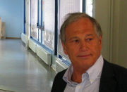

# 塞尔焦·费拉拉

**英文名：** Sergio Ferrara

**生卒：** 1945年5月2日 — 在世（截至资料整理日）

**主要领域：** 超引力、量子场论

肖像的作者、拍摄或创作年代及具体形式见图片来源。

## 生平简介

意大利理论物理学家，曾在弗拉斯卡蒂、CERN及加州大学洛杉矶分校工作。他研究超对称与引力的结合，并探索扩展超引力、黑洞和统一理论。

## 对物理的主要贡献

- 与弗里德曼、范纽文赫伊曾共同建立超引力
- 发展超对称杨—米尔斯理论
- 研究扩展超引力及超对称黑洞

## 肖像来源与许可

- 来源：[modern-extra-sergio-ferrara.png](https://th-dep.web.cern.ch/roster/ferrara-sergio)
- 作者／署名：见原图页面
- 许可：Copyrighted image; no transferable open licence verified. Permission must be confirmed before website publication.
- 本地文件：[16614d5bc1c19bc4fc1f-8bb7285ac9.png](../portraits/16614d5bc1c19bc4fc1f-8bb7285ac9.png)
- 原始来源说明：CERN Department of Theoretical Physics profile
- 授权状态：仅记录来源与本地档案副本；未确认可用于网站再发布，发布前须向权利人核实授权。

## 资料来源

- [Sergio Ferrara — Wikipedia reference biography](https://en.wikipedia.org/wiki/Sergio_Ferrara)
- [ICTP Dirac Medal — official laureate directory](https://www.ictp.it/prize/dirac-medal)

资料整理日期：2026-10-26。
