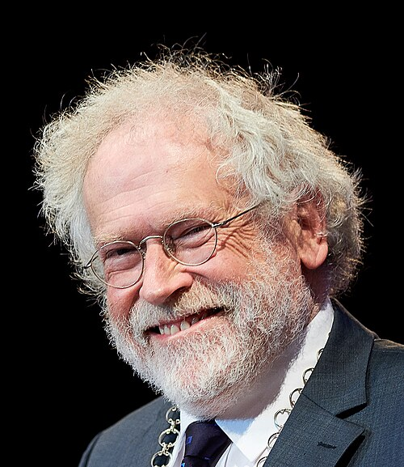

# 安东·蔡林格

**英文名：** Anton Zeilinger

**生卒：** 1945年5月20日 — 在世（截至资料整理日）

**主要领域：** 量子基础、量子信息

肖像的作者、拍摄或创作年代及具体形式见图片来源。

## 生平简介

安东·蔡林格出生于Ried im Innkreis, Austria，主要从事量子基础、量子信息研究。诺贝尔奖资料所列获奖时任职机构为University of Vienna、Institute for Quantum Optics and Quantum Information, Austrian Academy of Sciences。其代表成果包括开展纠缠光子实验并检验贝尔不等式，获2022年诺贝尔物理学奖。

## 对物理的主要贡献

- 开展纠缠光子实验并检验贝尔不等式
- 为量子信息科学的实验基础作出关键贡献

**诺贝尔物理学奖：** 2022

## 肖像来源与许可

- 来源：[Anton_Zeilinger,_2019_(49085194786)_(cropped).jpg](https://commons.wikimedia.org/wiki/File:Anton_Zeilinger,_2019_(49085194786)_(cropped).jpg)
- 作者／署名：CEU / Daniel Vegel; Central European University from Budapest, Hungary
- 许可：[CC BY 2.0](https://creativecommons.org/licenses/by/2.0)
- 本地文件：[f0e52069331da8a7dc33.jpg](../portraits/f0e52069331da8a7dc33.jpg)
- 原始来源说明：Anton Zeilinger, President of the Austrian Academy of Sciences making a speech at the Inauguration of the Central European University Vienna Campus on November 15, 2019 in Expedithalle, Vienna.

## 资料来源

- [Anton Zeilinger - Facts](https://www.nobelprize.org/prizes/physics/2022/zeilinger/facts/)
- [Nobel Prize official laureate API, id 1014](https://api.nobelprize.org/2.1/laureate/1014)
- [Wikipedia: Anton Zeilinger](https://en.wikipedia.org/wiki/Anton_Zeilinger)

资料整理日期：2026-10-26。
