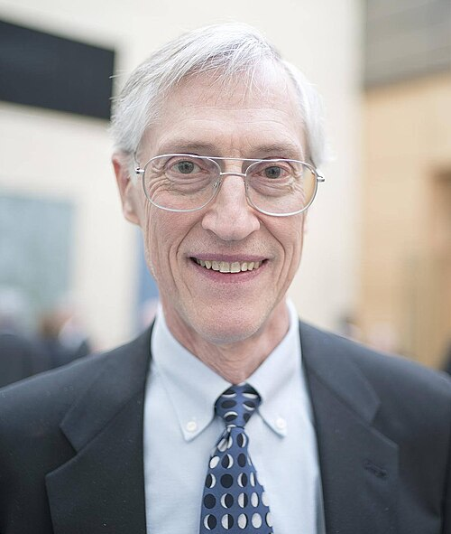

# 约翰·马瑟

**英文名：** John C. Mather

**生卒：** 1946年8月7日 — 在世（截至资料整理日）

**主要领域：** 宇宙学、宇宙微波背景

肖像的作者、拍摄或创作年代及具体形式见图片来源。

## 生平简介

约翰·马瑟出生于Roanoke, VA, USA，主要从事宇宙学、宇宙微波背景研究。诺贝尔奖资料所列获奖时任职机构为NASA Goddard Space Flight Center。其代表成果包括领导COBE卫星的相关科学工作并负责FIRAS实验，获2006年诺贝尔物理学奖。

## 对物理的主要贡献

- 领导COBE卫星的相关科学工作并负责FIRAS实验
- 精密验证宇宙微波背景近乎理想的黑体光谱

**诺贝尔物理学奖：** 2006

## 肖像来源与许可

- 来源：[John_Mather_(cropped).jpg](https://commons.wikimedia.org/wiki/File:John_Mather_%28cropped%29.jpg)
- 作者／署名：Christopher Michel (1967–)
- 许可：[CC BY 2.0](https://en.wikipedia.org/wiki/Flickr)
- 本地文件：[7f209d3e9672a66a2095.jpg](../portraits/7f209d3e9672a66a2095.jpg)
- 原始来源说明：John Mather

## 资料来源

- [John C. Mather - Facts](https://www.nobelprize.org/prizes/physics/2006/mather/facts/)
- [Nobel Prize official laureate API, id 804](https://api.nobelprize.org/2.1/laureate/804)
- [Wikipedia: John C. Mather](https://en.wikipedia.org/wiki/John_C._Mather)

资料整理日期：2026-10-26。
