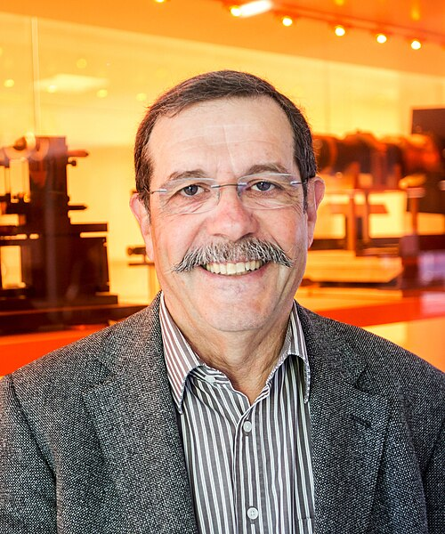

# 阿兰·阿斯佩

**英文名：** Alain Aspect

**生卒：** 1947年6月15日 — 在世（截至资料整理日）

**主要领域：** 量子基础、量子信息

肖像的作者、拍摄或创作年代及具体形式见图片来源。

## 生平简介

阿兰·阿斯佩出生于Agen, France，主要从事量子基础、量子信息研究。诺贝尔奖资料所列获奖时任职机构为Institut d’Optique Graduate School – Université Paris-Saclay、École Polytechnique。其代表成果包括开展纠缠光子实验并检验贝尔不等式，获2022年诺贝尔物理学奖。

## 对物理的主要贡献

- 开展纠缠光子实验并检验贝尔不等式
- 为量子信息科学的实验基础作出关键贡献

**诺贝尔物理学奖：** 2022

## 肖像来源与许可

- 来源：[Alain_Aspect_(26341660894)_(cropped).jpg](https://commons.wikimedia.org/wiki/File:Alain_Aspect_(26341660894)_(cropped).jpg)
- 作者／署名：Ecole polytechnique Université Paris-Saclay
- 许可：[CC BY-SA 2.0](https://creativecommons.org/licenses/by-sa/2.0)
- 本地文件：[55f89905c4050174c211.jpg](../portraits/55f89905c4050174c211.jpg)
- 原始来源说明：Mooc optique quantique

## 资料来源

- [Alain Aspect - Facts](https://www.nobelprize.org/prizes/physics/2022/aspect/facts/)
- [Nobel Prize official laureate API, id 1012](https://api.nobelprize.org/2.1/laureate/1012)
- [Wikipedia: Alain Aspect](https://en.wikipedia.org/wiki/Alain_Aspect)

资料整理日期：2026-10-26。
