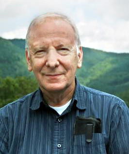

# 罗伯特·瓦尔德

**英文名：** Robert Wald

**生卒：** 1947年6月29日 — 在世（截至资料整理日）

**主要领域：** 广义相对论、量子场论

肖像的作者、拍摄或创作年代及具体形式见图片来源。

## 生平简介

美国理论物理学家，长期任教于芝加哥大学。他研究黑洞热力学、弯曲时空量子场论及引力理论的数学基础，所著广义相对论教材影响广泛。

## 对物理的主要贡献

- 将黑洞熵与诺特荷联系起来
- 建立弯曲时空量子场论的严密表述
- 研究黑洞热力学及引力稳定性

## 肖像来源与许可

- 来源：[Robert_Wald.jpg](https://commons.wikimedia.org/wiki/File:Robert_Wald.jpg)
- 作者／署名：Vetter, Ivonne
- 许可：[CC BY-SA 2.0 de](https://creativecommons.org/licenses/by-sa/2.0/de/deed.en)
- 本地文件：[bee4b688e3042f0d2898-6c04b2316e.jpg](../portraits/bee4b688e3042f0d2898-6c04b2316e.jpg)
- 原始来源说明：https://opc.mfo.de/detail?photo_id=16891

## 资料来源

- [ICTP2025 Dirac Medallists: scientific contributions](https://www.ictp.it/home/dirac-medallists-2025)
- [Robert Wald — Wikipedia reference biography](https://en.wikipedia.org/wiki/Robert_Wald)
- [Silver screen](https://mag.uchicago.edu/science-medicine/silver-screen)
- [Robert Wald awarded 2025 Albert Einstein Medal | News | Physical Sciences Division | The University of Chicago](https://physicalsciences.uchicago.edu/news/article/robert-wald-awarded-2025-albert-einstein-medal/)
- [ICTP Dirac Medal — official laureate directory](https://www.ictp.it/prize/dirac-medal)

资料整理日期：2026-10-26。
