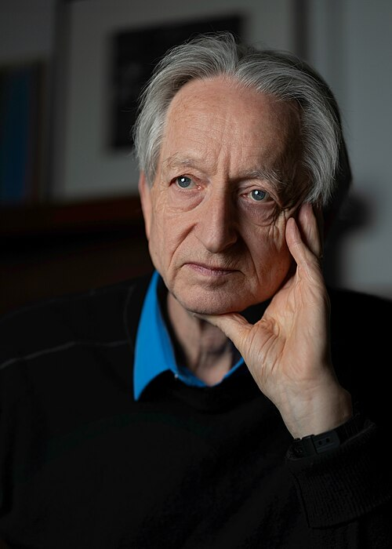

# 杰弗里·辛顿

**英文名：** Geoffrey Hinton

**生卒：** 1947年12月6日 — 在世（截至资料整理日）

**主要领域：** 统计学习、神经网络

肖像的作者、拍摄或创作年代及具体形式见图片来源。

## 生平简介

杰弗里·辛顿出生于London, United Kingdom，主要从事统计学习、神经网络研究。诺贝尔奖资料所列获奖时任职机构为University of Toronto。其代表成果包括参与发展玻尔兹曼机等基于统计物理的学习模型，获2024年诺贝尔物理学奖。

## 对物理的主要贡献

- 参与发展玻尔兹曼机等基于统计物理的学习模型
- 推动多层神经网络的表示学习方法

**诺贝尔物理学奖：** 2024

## 肖像来源与许可

- 来源：[Geoffrey_Hinton_in_2026.jpg](https://commons.wikimedia.org/wiki/File:Geoffrey_Hinton_in_2026.jpg)
- 作者／署名：Cmichel67
- 许可：[CC BY-SA 4.0](https://creativecommons.org/licenses/by-sa/4.0)
- 本地文件：[3b3cc9013294e085f359.jpg](../portraits/3b3cc9013294e085f359.jpg)
- 原始来源说明：Own work

## 资料来源

- [Geoffrey Hinton - Facts](https://www.nobelprize.org/prizes/physics/2024/hinton/facts/)
- [Nobel Prize official laureate API, id 1038](https://api.nobelprize.org/2.1/laureate/1038)
- [Wikipedia: Geoffrey Hinton](https://en.wikipedia.org/wiki/Geoffrey_Hinton)

资料整理日期：2026-10-26。
