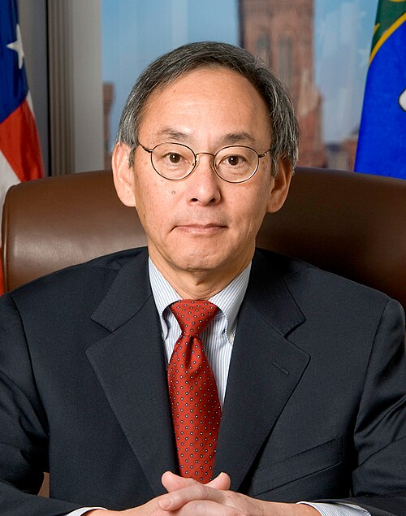

# 朱棣文

**英文名：** Steven Chu

**生卒：** 1948年2月28日 — 在世（截至资料整理日）

**主要领域：** 原子物理、激光冷却

肖像的作者、拍摄或创作年代及具体形式见图片来源。

## 生平简介

朱棣文出生于St. Louis, MO, USA，主要从事原子物理、激光冷却研究。诺贝尔奖资料所列获奖时任职机构为Stanford University。其代表成果包括发展利用激光冷却和俘获原子的方法，获1997年诺贝尔物理学奖。

## 对物理的主要贡献

- 发展利用激光冷却和俘获原子的方法
- 为超冷原子、精密测量和量子气体实验提供基础

**诺贝尔物理学奖：** 1997

## 肖像来源与许可

- 来源：[Steven_Chu_official_DOE_portrait_crop.jpg](https://commons.wikimedia.org/wiki/File:Steven_Chu_official_DOE_portrait_crop.jpg)
- 作者／署名：Department of Energy
- 许可：Public domain
- 本地文件：[6749346d04d0bbc30d74.jpg](../portraits/6749346d04d0bbc30d74.jpg)
- 原始来源说明：Obtained via email from Department of Energy.

## 资料来源

- [Steven Chu - Facts](https://www.nobelprize.org/prizes/physics/1997/chu/facts/)
- [Nobel Prize official laureate API, id 152](https://api.nobelprize.org/2.1/laureate/152)
- [Wikipedia: Steven Chu](https://en.wikipedia.org/wiki/Steven_Chu)

资料整理日期：2026-10-26。
