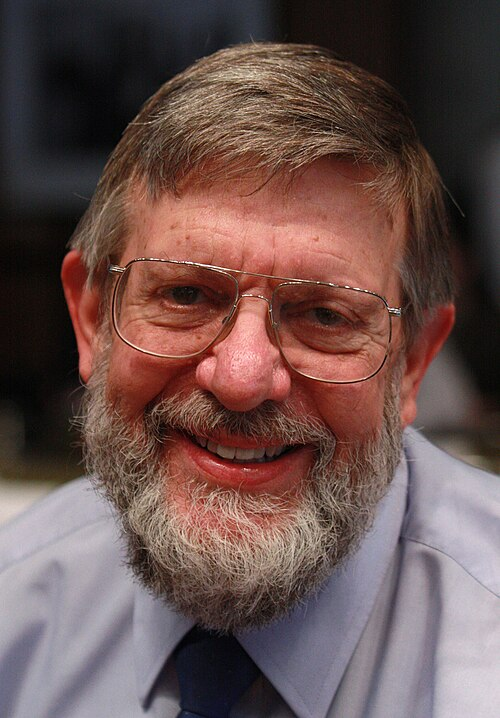

# 威廉·丹尼尔·菲利普斯

**英文名：** William D. Phillips

**生卒：** 1948年11月5日 — 在世（截至资料整理日）

**主要领域：** 原子物理、激光冷却

肖像的作者、拍摄或创作年代及具体形式见图片来源。

## 生平简介

威廉·丹尼尔·菲利普斯出生于Wilkes-Barre, PA, USA，主要从事原子物理、激光冷却研究。诺贝尔奖资料所列获奖时任职机构为National Institute of Standards and Technology。其代表成果包括发展利用激光冷却和俘获原子的方法，获1997年诺贝尔物理学奖。

## 对物理的主要贡献

- 发展利用激光冷却和俘获原子的方法
- 为超冷原子、精密测量和量子气体实验提供基础

**诺贝尔物理学奖：** 1997

## 肖像来源与许可

- 来源：[William_D._Phillips.jpg](https://commons.wikimedia.org/wiki/File:William_D._Phillips.jpg)
- 作者／署名：Markus Pössel (User name: Mapos)
- 许可：[CC BY-SA 3.0](https://creativecommons.org/licenses/by-sa/3.0)
- 本地文件：[bee3ef03af1354ac8585.jpg](../portraits/bee3ef03af1354ac8585.jpg)
- 原始来源说明：Own work

## 资料来源

- [William D. Phillips - Facts](https://www.nobelprize.org/prizes/physics/1997/phillips/facts/)
- [Nobel Prize official laureate API, id 154](https://api.nobelprize.org/2.1/laureate/154)
- [Wikipedia: William Daniel Phillips](https://en.wikipedia.org/wiki/William_Daniel_Phillips)

资料整理日期：2026-10-26。
