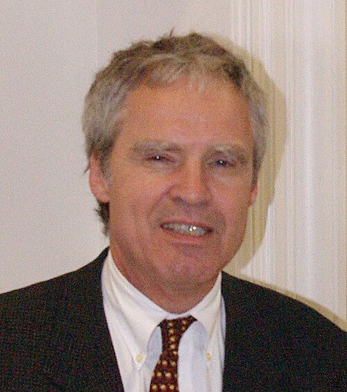

# 霍斯特·施特默

**英文名：** Horst L. Störmer

**生卒：** 1949年4月6日 — 在世（截至资料整理日）

**主要领域：** 凝聚态物理、分数量子霍尔效应

肖像的作者、拍摄或创作年代及具体形式见图片来源。

## 生平简介

霍斯特·施特默出生于Frankfurt-on-the-Main, West Germany (now Germany)，主要从事凝聚态物理、分数量子霍尔效应研究。诺贝尔奖资料所列获奖时任职机构为Columbia University。其代表成果包括研究二维电子体系的分数量子霍尔现象，获1998年诺贝尔物理学奖。

## 对物理的主要贡献

- 研究二维电子体系的分数量子霍尔现象
- 揭示强关联电子形成的具有分数化激发的新量子态

**诺贝尔物理学奖：** 1998

## 肖像来源与许可

- 来源：[Horst_Störmer_cropped.jpg](https://commons.wikimedia.org/wiki/File:Horst_St%C3%B6rmer_cropped.jpg)
- 作者／署名：Mark Pellegrini, User:Raul654
- 许可：[CC BY-SA 3.0](http://creativecommons.org/licenses/by-sa/3.0/)
- 本地文件：[a5752dce22f4e29d21ee.jpg](../portraits/a5752dce22f4e29d21ee.jpg)
- 原始来源说明：Own work

## 资料来源

- [Horst L. Störmer - Facts](https://www.nobelprize.org/prizes/physics/1998/stormer/facts/)
- [Nobel Prize official laureate API, id 156](https://api.nobelprize.org/2.1/laureate/156)
- [Wikipedia: Horst Ludwig Störmer](https://en.wikipedia.org/wiki/Horst_Ludwig_St%C3%B6rmer)

资料整理日期：2026-10-26。
