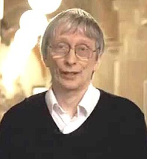

# 戴维·多伊奇

**英文名：** David Deutsch

**生卒：** 1953年5月18日 — 在世（截至资料整理日）

**主要领域：** 量子信息、量子基础

肖像的作者、拍摄或创作年代及具体形式见图片来源。

## 生平简介

以色列出生的英国理论物理学家，长期与牛津大学联系。他把量子理论同计算普适性结合，研究量子计算机、量子算法及量子理论的解释。

## 对物理的主要贡献

- 提出普适量子计算机模型
- 与约萨发展展示量子计算优势的算法
- 研究量子理论的多世界表述及构造理论

## 肖像来源与许可

- 来源：[David_Deutsch_(cropped).jpg](https://commons.wikimedia.org/wiki/File:David_Deutsch_(cropped).jpg)
- 作者／署名：Simon Benjamin
- 许可：[CC BY 3.0](https://creativecommons.org/licenses/by/3.0)
- 本地文件：[efe753da9cd2aa6627a8-fded4d25dd.jpg](../portraits/efe753da9cd2aa6627a8-fded4d25dd.jpg)
- 原始来源说明：YouTube: https://www.youtube.com/watch?v=8DH2xwIYuT0 – View/save archived versions on archive.org

## 资料来源

- [David Deutsch — Wikipedia reference biography](https://en.wikipedia.org/wiki/David_Deutsch)
- [Dirac Medallists 2017 | ICTP](https://www.ictp.it/about-ictp/prizes-awards/the-dirac-medal/the-medallists/dirac-medallists-2017.aspx)
- [ICTP Dirac Medal — official laureate directory](https://www.ictp.it/prize/dirac-medal)

资料整理日期：2026-10-26。
