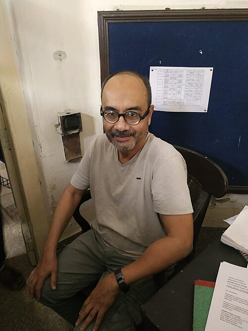

# 阿肖克·森

**英文名：** Ashoke Sen

**生卒：** 1956年7月15日 — 在世（截至资料整理日）

**主要领域：** 弦理论、量子引力

肖像的作者、拍摄或创作年代及具体形式见图片来源。

## 生平简介

印度理论物理学家，曾在美国研究，长期任职印度哈里什-钱德拉研究所，后加入国际理论科学中心。他在弦对偶、黑洞微观态及弦场论方面作出基础贡献。

## 对物理的主要贡献

- 为弦理论中的强弱耦合对偶提供关键证据
- 研究极值黑洞熵及微观态计数
- 发展快子凝聚和弦场论

## 肖像来源与许可

- 来源：[Dr._Ashoke_Sen_in_Physics_department_of_Scottish_Church_College.jpg](https://commons.wikimedia.org/wiki/File:Dr._Ashoke_Sen_in_Physics_department_of_Scottish_Church_College.jpg)
- 作者／署名：Souravdas1998
- 许可：[CC BY-SA 4.0](https://creativecommons.org/licenses/by-sa/4.0)
- 本地文件：[676445beed52b087c0f4-1ce5b37d11.jpg](../portraits/676445beed52b087c0f4-1ce5b37d11.jpg)
- 原始来源说明：Own work

## 资料来源

- [Ashoke Sen — Wikipedia reference biography](https://en.wikipedia.org/wiki/Ashoke_Sen)
- [Dirac Medallists 2014 | ICTP](https://www.ictp.it/about-ictp/prizes-awards/the-dirac-medal/the-medallists/dirac-medallists-2014.aspx)
- [ICTP Prize Winner 1989 | ICTP](https://www.ictp.it/about-ictp/prizes-awards/the-ictp-prize/the-prize-winners/ictp-prize-winner-1989.aspx)
- [ICTP Dirac Medal — official laureate directory](https://www.ictp.it/prize/dirac-medal)

资料整理日期：2026-10-26。
