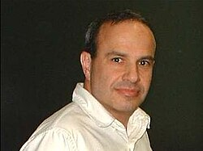

# 内森·塞伯格

**英文名：** Nathan Seiberg

**生卒：** 1956年9月22日 — 在世（截至资料整理日）

**主要领域：** 量子场论、弦理论

肖像的作者、拍摄或创作年代及具体形式见图片来源。

## 生平简介

以色列出生的美国理论物理学家，曾在魏茨曼研究所及罗格斯大学工作，后任职普林斯顿高等研究院。他用对偶、对称性和精确结果揭示强耦合量子场论的结构。

## 对物理的主要贡献

- 与维滕求解重要的超对称规范理论低能动力学
- 提出塞伯格对偶
- 发展量子场论的广义对称性及非微扰研究

## 肖像来源与许可

- 来源：[Nathan_Seiberg_at_Harvard_cropped.jpg](https://commons.wikimedia.org/wiki/File:Nathan_Seiberg_at_Harvard_cropped.jpg)
- 作者／署名：Nathan_Seiberg_at_Harvard.jpg: by Lumidek derivative work: Bender235 (talk)
- 许可：[CC BY-SA 3.0](http://creativecommons.org/licenses/by-sa/3.0/)
- 本地文件：[c8f302d4e6e8052db73e-06be35dc30.jpg](../portraits/c8f302d4e6e8052db73e-06be35dc30.jpg)
- 原始来源说明：Nathan_Seiberg_at_Harvard.jpg

## 资料来源

- [Nathan Seiberg — Institute for Advanced Study](https://www.ias.edu/sns/seiberg)
- [Nathan Seiberg — Wikipedia reference biography](https://en.wikipedia.org/wiki/Nathan_Seiberg)
- [ICTP Dirac Medal — official laureate directory](https://www.ictp.it/prize/dirac-medal)

资料整理日期：2026-10-26。
