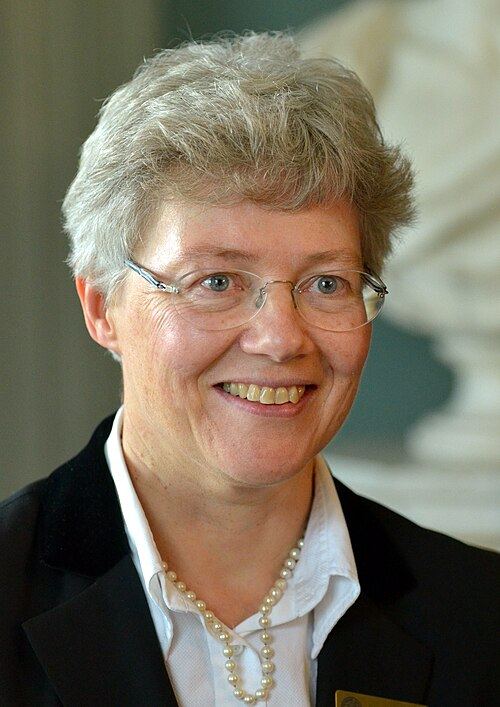

# 安妮·吕利耶

**英文名：** Anne L’Huillier

**生卒：** 1958年8月16日 — 在世（截至资料整理日）

**主要领域：** 阿秒物理、超快光学

肖像的作者、拍摄或创作年代及具体形式见图片来源。

## 生平简介

安妮·吕利耶出生于Paris, France，主要从事阿秒物理、超快光学研究。诺贝尔奖资料所列获奖时任职机构为Lund University。其代表成果包括发展产生阿秒光脉冲的实验方法，获2023年诺贝尔物理学奖。

## 对物理的主要贡献

- 发展产生阿秒光脉冲的实验方法
- 使探测物质中电子的超快动力学成为可能

**诺贝尔物理学奖：** 2023

## 肖像来源与许可

- 来源：[Anne_LHuiller_01.JPG](https://commons.wikimedia.org/wiki/File:Anne_LHuiller_01.JPG)
- 作者／署名：Bengt Oberger
- 许可：[CC BY-SA 3.0](https://creativecommons.org/licenses/by-sa/3.0)
- 本地文件：[527cdcae5530ee583934.jpg](../portraits/527cdcae5530ee583934.jpg)
- 原始来源说明：Own work

## 资料来源

- [Anne L’Huillier - Facts](https://www.nobelprize.org/prizes/physics/2023/lhuillier/facts/)
- [Nobel Prize official laureate API, id 1028](https://api.nobelprize.org/2.1/laureate/1028)
- [Wikipedia: Anne L'Huillier](https://en.wikipedia.org/wiki/Anne_L%27Huillier)

资料整理日期：2026-10-26。
