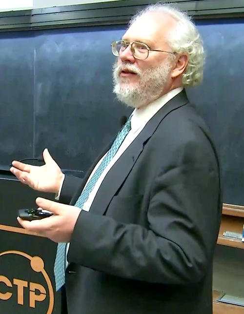

# 彼得·肖尔

**英文名：** Peter Shor

**生卒：** 1959年8月14日 — 在世（截至资料整理日）

**主要领域：** 量子信息、数学物理

肖像的作者、拍摄或创作年代及具体形式见图片来源。

## 生平简介

美国数学家与量子计算研究者，曾在贝尔实验室工作，后任教于麻省理工学院。他的量子算法揭示了量子计算对经典密码问题的潜在影响，并推动量子纠错理论。

## 对物理的主要贡献

- 提出多项式时间整数分解与离散对数量子算法
- 建立早期量子纠错码
- 发展容错量子计算的理论基础

## 肖像来源与许可

- 来源：[Peter_Shor_2017_Dirac_Medal_Award_Ceremony.png](https://commons.wikimedia.org/wiki/File:Peter_Shor_2017_Dirac_Medal_Award_Ceremony.png)
- 作者／署名：International Centre for Theoretical Physics
- 许可：[CC BY 3.0](https://creativecommons.org/licenses/by/3.0)
- 本地文件：[884aa9443676a5d2013f-22964b8259.png](../portraits/884aa9443676a5d2013f-22964b8259.png)
- 原始来源说明：YouTube: https://www.youtube.com/watch?v=J7HeDX_7Heg&t=7075 – View/save archived versions on archive.org

## 资料来源

- [Peter Shor — Wikipedia reference biography](https://en.wikipedia.org/wiki/Peter_Shor)
- [Department of Mathematics | MIT Course Catalog](https://catalog.mit.edu/schools/science/mathematics/#facultystafftext)
- [Peter Shor wins Breakthrough Prize in Fundamental Physics | MIT News | Massachusetts Institute of Technology](https://news.mit.edu/2022/shor-spielman-breakthrough-prize-0922)
- [SCS News Releases](https://www.cs.cmu.edu/afs/cs/usr/copetas/www/public/pr/nov5-99.html)

资料整理日期：2026-10-26。
