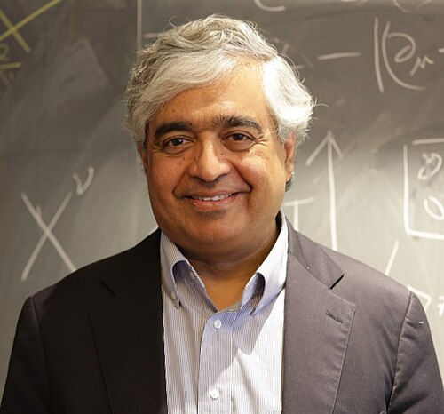

# 苏比尔·萨奇德夫

**英文名：** Subir Sachdev

**生卒：** 1961年12月2日 — 在世（截至资料整理日）

**主要领域：** 凝聚态物理、量子多体

肖像的作者、拍摄或创作年代及具体形式见图片来源。

## 生平简介

印度出生的理论物理学家，曾在耶鲁大学研究，后任教于哈佛大学。他研究量子临界现象、强关联电子和奇异金属，并把凝聚态问题与全息理论联系起来。

## 对物理的主要贡献

- 发展量子相变与量子临界理论
- 与叶锦武提出后来SYK研究的重要多体模型
- 研究强关联电子、奇异金属及全息联系

## 肖像来源与许可

- 来源：[R36C4122s.jpg](https://commons.wikimedia.org/wiki/File:R36C4122s.jpg)
- 作者／署名：Ctindusganges
- 许可：[CC BY-SA 4.0](https://creativecommons.org/licenses/by-sa/4.0)
- 本地文件：[06025bcdac16da0e161a-3f55b82d86.jpg](../portraits/06025bcdac16da0e161a-3f55b82d86.jpg)
- 原始来源说明：Own work

## 资料来源

- [Subir Sachdev — Wikipedia reference biography](https://en.wikipedia.org/wiki/Subir_Sachdev)
- [ICTP Dirac Medal — official laureate directory](https://www.ictp.it/prize/dirac-medal)

资料整理日期：2026-10-26。
