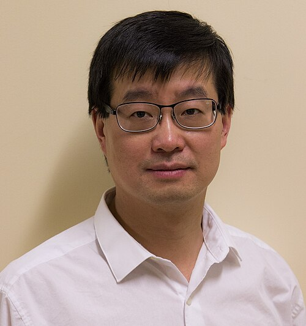

# 叶军

**英文名：** Jun Ye

**生卒：** 1967年 — 在世（截至资料整理日）

**主要领域：** 原子物理、精密测量

肖像的作者、拍摄或创作年代及具体形式见图片来源。

## 生平简介

出生于上海的美国实验物理学家，在科罗拉多大学师从霍尔，后长期在JILA及美国国家标准与技术研究院工作。他以超稳激光、光晶格原子钟和超冷分子研究连接计量学与量子物理。

## 对物理的主要贡献

- 发展锶光晶格原子钟及高精度光频测量
- 研究光频梳和超稳激光
- 制备与操控超冷分子和量子气体

## 史料说明

- 核读NIST及JILA资料确认出生年份1967年，未将其他网页未经一致核对的月日加入本档案。

## 肖像来源与许可

- 来源：[JunYe_1_a.jpg](https://commons.wikimedia.org/wiki/File:JunYe_1_a.jpg)
- 作者／署名：KHughesC
- 许可：[CC BY-SA 4.0](https://creativecommons.org/licenses/by-sa/4.0)
- 本地文件：[fbf4ce625aa9913970f9-764a5ebbbe.jpg](../portraits/fbf4ce625aa9913970f9-764a5ebbbe.jpg)
- 原始来源说明：Own work

## 资料来源

- [Jun Ye — NIST](https://www.nist.gov/people/jun-ye)
- [Jun Ye: A Timely Profile — NIST](https://www.nist.gov/news-events/news/2023/06/jun-ye-timely-profile)
- [Jun Ye — JILA, University of Colorado](https://www.colorado.edu/jila/jun-ye)
- [Jun Ye — Wikipedia reference biography](https://en.wikipedia.org/wiki/Jun_Ye)

资料整理日期：2026-10-26。
