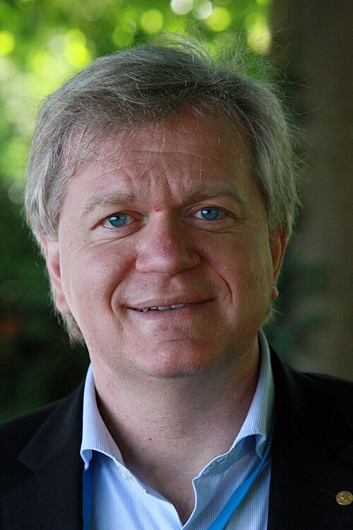

# 布莱恩·施密特

**英文名：** Brian P. Schmidt

**生卒：** 1967年2月24日 — 在世（截至资料整理日）

**主要领域：** 宇宙学、观测天文学

肖像的作者、拍摄或创作年代及具体形式见图片来源。

## 生平简介

布莱恩·施密特出生于Missoula, MT, USA，主要从事宇宙学、观测天文学研究。诺贝尔奖资料所列获奖时任职机构为Australian National University。其代表成果包括通过遥远Ia型超新星观测发现宇宙加速膨胀，获2011年诺贝尔物理学奖。

## 对物理的主要贡献

- 通过遥远Ia型超新星观测发现宇宙加速膨胀
- 为暗能量研究提供关键观测依据

**诺贝尔物理学奖：** 2011

## 肖像来源与许可

- 来源：[Brian_Schmidt.jpg](https://commons.wikimedia.org/wiki/File:Brian_Schmidt.jpg)
- 作者／署名：Markus Pössel (User name: Mapos)
- 许可：[CC BY-SA 3.0](https://creativecommons.org/licenses/by-sa/3.0)
- 本地文件：[31999cc32f3c9f607254.jpg](../portraits/31999cc32f3c9f607254.jpg)
- 原始来源说明：Own work

## 资料来源

- [Brian P. Schmidt - Facts](https://www.nobelprize.org/prizes/physics/2011/schmidt/facts/)
- [Nobel Prize official laureate API, id 865](https://api.nobelprize.org/2.1/laureate/865)
- [Wikipedia: Brian Schmidt](https://en.wikipedia.org/wiki/Brian_Schmidt)

资料整理日期：2026-10-26。
